<div align="center">


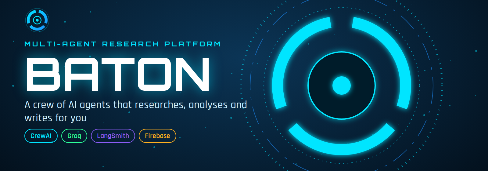

<br>


[](https://crewai-baton.vercel.app)


**Describe a topic. Three AI agents hand the work to each other. Get a structured report, and watch every step live.**

[Live demo](https://crewai-baton.vercel.app) · [Features](#features) · [Screenshots](#screenshots) · [How it works](#how-it-works) · [Quick start](#quick-start-local) · [Deploy](#deploy-vercel--firebase) · [API](#api-reference) · [FAQ](#troubleshooting)

</div>

---

## Table of contents

- [Overview](#overview)
- [Features](#features)
- [Screenshots](#screenshots)
- [How it works](#how-it-works)
- [Architecture](#architecture)
- [Tech stack](#tech-stack)
- [Project structure](#project-structure)
- [Quick start (local)](#quick-start-local)
- [Deploy (Vercel + Firebase)](#deploy-vercel--firebase)
- [Environment variables](#environment-variables)
- [API reference](#api-reference)
- [Testing](#testing)
- [Troubleshooting](#troubleshooting)
- [Roadmap](#roadmap)
- [Author](#author)

## Overview

Baton is a multi-agent research platform. You enter a topic, choose a report length and a writing voice, and a crew of three specialist agents takes over:

| Agent | Role | Output |
|-------|------|--------|
| **Researcher (R-01)** | Gathers facts, concepts, developments and applications. Told never to invent sources | Research notes |
| **Analyst (A-02)** | Weighs insights, risks, opportunities and recommendations | Analysis |
| **Editor (E-03)** | Writes the final structured Markdown report | Finished report |

A futuristic mission-control dashboard shows progress, timings, word counts and previews as each agent works. Finished reports are saved privately to your account, and every agent run can be traced in LangSmith.

## Features

- **Three specialist agents** with a visible relay and clear hand-offs
- **Live mission control**: arc-reactor progress, agent cards, mission log and elapsed timer
- **Choose length and voice**: short, standard or deep, in five tones
- **Login first**: the site opens at the login page and shows the main page after sign in
- **Secure accounts**: email and password or **Google sign-in**, with a private per-user archive (Firebase Auth and Firestore)
- **LangSmith tracing** of every agent run with agent name, user and tags
- **Export anywhere**: copy text, download Markdown, or print to PDF
- **Full website**: hero, features, how it works, use cases and FAQ, responsive on phones
- **Two modes**: real CrewAI crew locally, serverless agent stages in the cloud

## Screenshots

<div align="center">

| Landing page | Mission control (ready) |
|:---:|:---:|
| 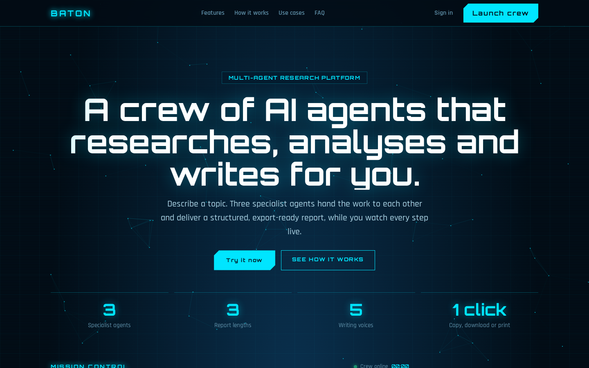 | 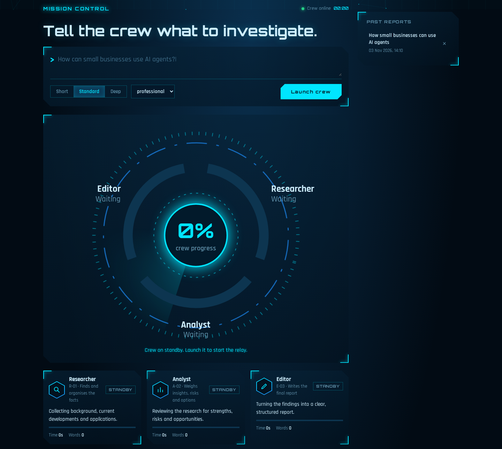 |

| Crew complete | Finished report |
|:---:|:---:|
| 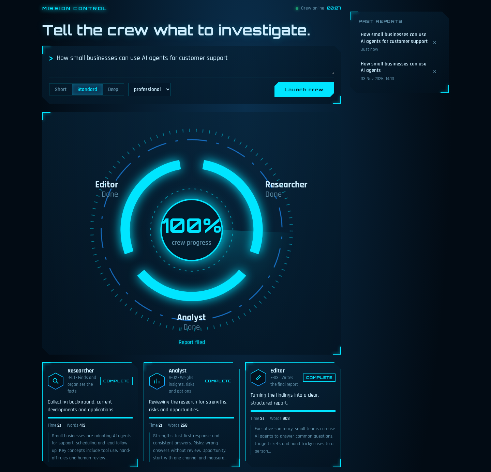 | 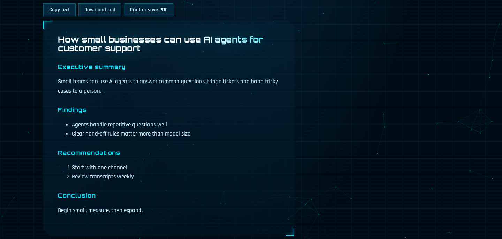 |

| Sign in | Create account |
|:---:|:---:|
| 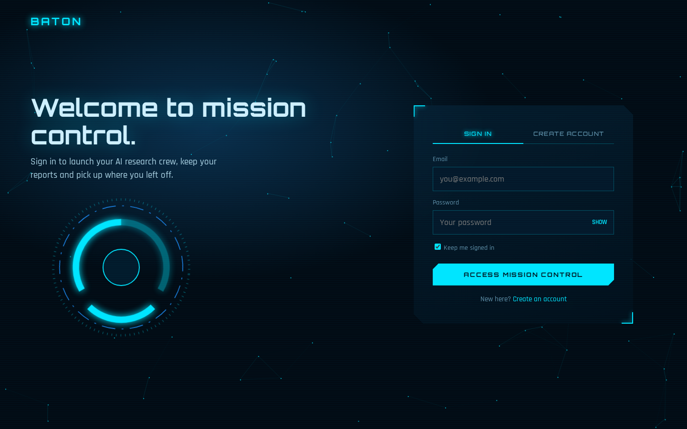 | 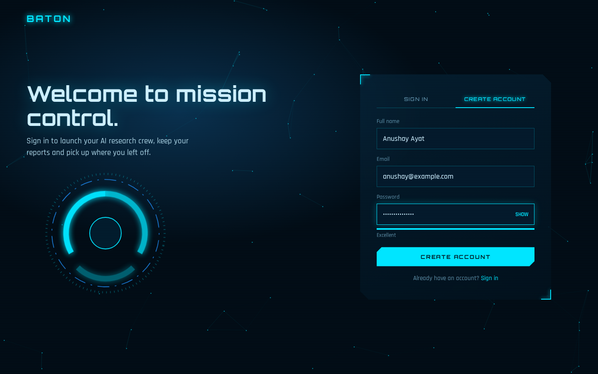 |

</div>

> Screenshots come from the demo build, which uses sample data in place of live model output.

## Documentation

| File | Description |
|------|-------------|
| [Project report (PDF)](docs/Baton_Report.pdf) | Full project report with diagrams and screenshots |
| [Project report (Word)](docs/Baton_Report.docx) | Editable version of the report |
| [Presentation (PowerPoint)](docs/Baton_Presentation.pptx) | 30-slide presentation of the project |

## How it works

<div align="center">
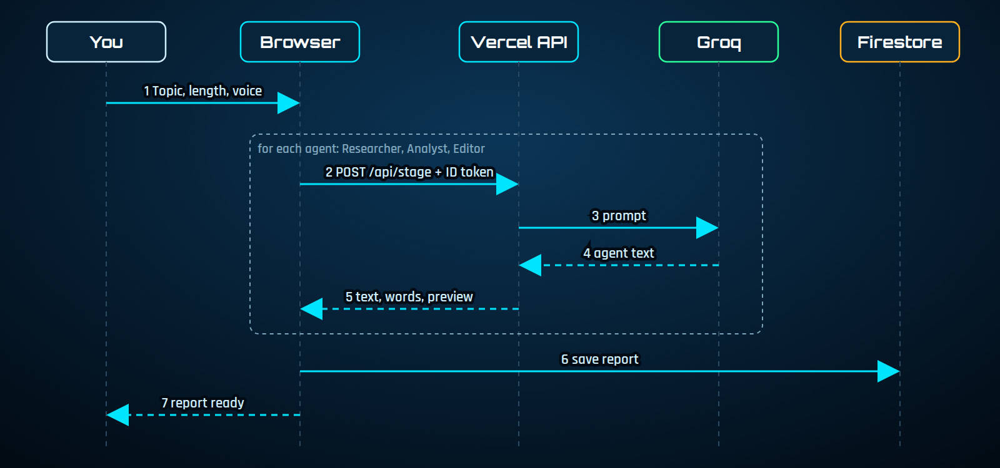
</div>

1. You enter a topic, length and voice.
2. The browser calls the API once per agent and passes earlier output forward.
3. The API verifies your Firebase token, asks the model and sends a trace to LangSmith.
4. When the Editor finishes, the report is saved to your Firestore archive.

## Architecture

<div align="center">
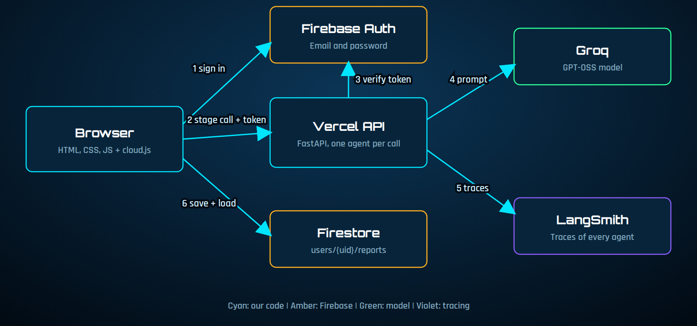
</div>

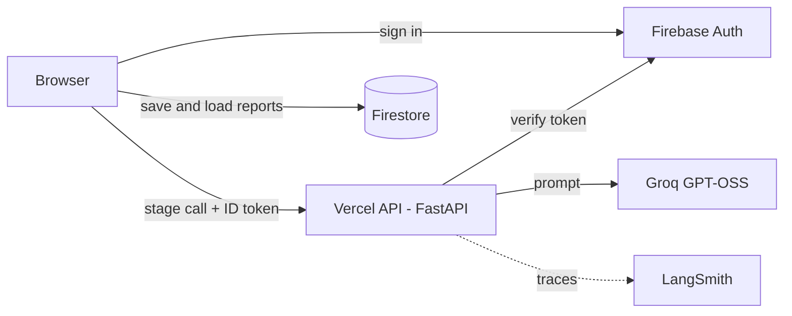

| | Local mode | Cloud mode |
|---|---|---|
| Agents | Real CrewAI crew | Same roles and prompts, one API call each |
| Server | `main.py` (FastAPI) | `api/index.py` on Vercel |
| Accounts | SQLite with hashed passwords | Firebase Authentication |
| Reports | JSON files in `reports/` | Firestore `users/{uid}/reports` |
| Tracing | One trace per crew run | One trace per agent |

Cloud mode runs each agent as a short request because a full CrewAI run takes minutes and CrewAI is a heavy dependency for serverless functions.

<div align="center">
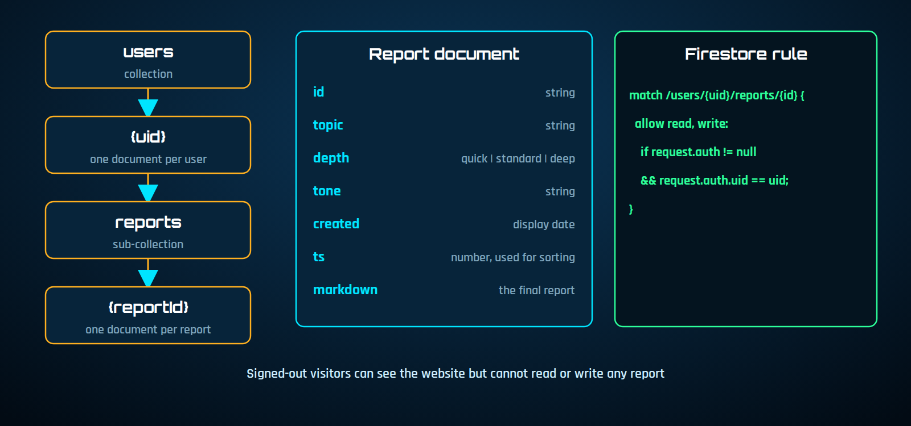
</div>

## Tech stack

| Layer | Technology |
|-------|------------|
| Backend | Python, FastAPI, Uvicorn |
| Agents | CrewAI (local), direct Groq calls (cloud) |
| Model | GPT-OSS served by Groq |
| Observability | LangSmith |
| Auth and data | Firebase Authentication, Cloud Firestore |
| Hosting | Vercel (and optionally Firebase Hosting) |
| Frontend | HTML, CSS, JavaScript, marked, DOMPurify |

## Project structure

```
crewai-baton/
├── api/index.py             # Vercel API: agent stages, token check, LangSmith
├── public/                  # The website (HTML, CSS and JS in separate files)
│   ├── index.html           # Website and mission control (markup only)
│   ├── login.html           # Sign in and create account (markup only)
│   ├── favicon.svg          # Browser tab icon
│   ├── img/                 # Logo (icon, wordmark) and app icons
│   ├── css/
│   │   ├── hud.css          # Base HUD style, mission control, report, archive
│   │   ├── agents.css       # Agent cards and mission log
│   │   ├── effects.css      # Particles, shining title, radar sweep, pulses
│   │   ├── site.css         # Navigation, hero, sections, FAQ, footer
│   │   └── login.css        # Login page
│   └── js/
│       ├── mission.js       # Reactor, launch, live stream, report viewer, archive
│       ├── agents.js        # Agent cards, mission log, timers
│       ├── particles.js     # Animated background (both pages)
│       ├── effects.js       # Pulse rings, launch flash, 3D tilt, typing text
│       ├── reveal.js        # Scroll reveal
│       ├── nav-auth.js      # Sign in / sign out in the navigation
│       ├── login.js         # Login page logic, Google sign-in
│       ├── auth-guard.js    # Sends visitors who are not signed in to the login page
│       ├── cloud.js         # Firebase and Vercel adapter (cloud mode)
│       └── firebase-config.js  # Your Firebase web config
├── main.py                  # Local server with the real CrewAI crew
├── llm_patch.py             # Groq cache_breakpoint fix for CrewAI
├── docs/                    # Logo, banner, social preview, screenshots, diagrams
├── vercel.json  firebase.json  firestore.rules  .firebaserc
├── requirements.txt         # Cloud (light)
├── requirements-local.txt   # Local (CrewAI)
├── DEPLOY.md                # Step-by-step deployment
└── .env.example
```

### Logo and brand

| File | Use |
|------|-----|
| `public/img/logo.svg` | Icon only (arc reactor mark) |
| `public/img/logo-wordmark.svg` | Icon with BATON text, for dark backgrounds |
| `public/img/logo-wordmark-dark.svg` | Icon with BATON text, for light backgrounds |
| `public/favicon.svg`, `public/img/*.png` | Browser tab icon and app icons |
| `docs/social-preview.png` | GitHub social preview (Settings, General, Social preview, upload this image) |

Colours: `#00E5FF` cyan, `#1E90FF` blue, `#020B14` void, `#07243A` panel. Fonts: Orbitron and Rajdhani.

## Quick start (local)

```bash
git clone https://github.com/scientistayat-engineer/crewai-baton.git
cd crewai-baton

python -m venv venv
venv\Scripts\activate            # Windows
# source venv/bin/activate       # macOS / Linux

pip install -r requirements-local.txt
copy .env.example .env           # then add your GROQ_API_KEY
python main.py
```

Open **http://127.0.0.1:8000**. Leave `public/js/firebase-config.js` as it is and the app uses the local server and its own accounts.

## Deploy (Vercel + Firebase)

1. **Firebase:** create a project, enable Email/Password, create Firestore, paste the web config into `public/js/firebase-config.js` and publish `firestore.rules`.
2. **LangSmith:** create an API key and a project named `baton`.
3. **Vercel:** import the GitHub repo, add the environment variables below and deploy.
4. **Authorised domains:** add your Vercel domain in Firebase Authentication settings.
5. **Verify:** open `/api/health`, create an account and launch a crew.

<div align="center">
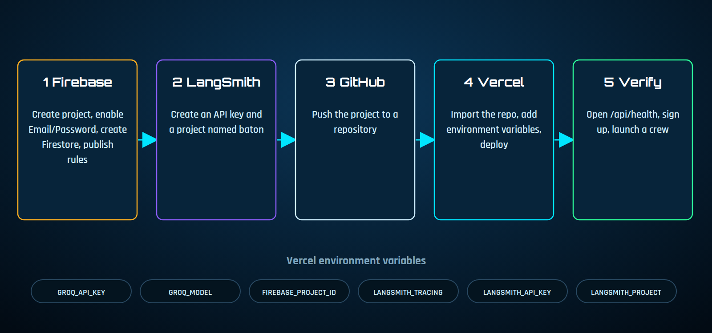
</div>

Live site: **https://crewai-baton.vercel.app**. Full walkthrough: [DEPLOY.md](DEPLOY.md).

## Environment variables

| Variable | Where | Purpose |
|----------|-------|---------|
| `GROQ_API_KEY` | Local and Vercel | Groq model access |
| `GROQ_MODEL` | Local and Vercel | `groq/openai/gpt-oss-20b` locally, `openai/gpt-oss-20b` on Vercel |
| `FIREBASE_PROJECT_ID` | Vercel | Verifies login tokens |
| `LANGSMITH_TRACING` | Local and Vercel | Set to `true` to enable tracing |
| `LANGSMITH_API_KEY` | Local and Vercel | LangSmith access |
| `LANGSMITH_PROJECT` | Local and Vercel | Project name, for example `baton` |
| `CORS_ORIGINS` | Vercel | Optional, only if the site is on Firebase Hosting |

Never commit your real `.env` file. The `.gitignore` already excludes it.

## API reference

**Cloud (`api/index.py`)**

| Endpoint | Method | Description |
|----------|--------|-------------|
| `/api/stage` | POST | Runs one agent: Researcher (0), Analyst (1) or Editor (2). Needs a Firebase ID token |
| `/api/health` | GET | Model name, whether auth is on, whether tracing is on |

```json
POST /api/stage
{ "stage": 0, "topic": "AI agents for support", "depth": "standard", "tone": "professional" }

{ "stage": 0, "agent": "Researcher", "text": "...", "words": 412, "preview": "..." }
```

**Local (`main.py`)**

| Endpoint | Method | Description |
|----------|--------|-------------|
| `/api/run` | POST | Starts a crew run |
| `/api/stream/{id}` | GET | Live progress (server-sent events) |
| `/api/history` | GET | List saved reports |
| `/api/report/{id}` | GET / DELETE | Open or delete a report |
| `/api/report/{id}/download` | GET | Download as Markdown |
| `/api/auth/signup`, `login`, `me`, `logout` | POST / GET | Local accounts |

## Testing

| Test | Result |
|------|--------|
| API stages return the right agent in order | Passed (simulated) |
| Missing earlier output returns 400, missing token returns 401 | Passed (simulated) |
| Cloud browser flow: login, launch, three stages, report saved, history, sign out | Passed (simulated) |
| Login page: errors, access granted, password strength | Passed (simulated) |
| Live run on the deployed site (Vercel, Firebase, Groq, Google sign-in) | Passed |

## Troubleshooting

| Problem | Fix |
|---------|-----|
| `RuntimeError: Add GROQ_API_KEY` | Create `.env` (not `.env.txt`) and add the key |
| `ModuleNotFoundError` | Activate the venv and run `pip install -r requirements-local.txt` |
| Groq error about `cache_breakpoint` | Already handled by `llm_patch.py`; keep it next to `main.py` |
| Redirected to login again and again | Add your domain to Firebase authorised domains |
| 401 "session expired" | `FIREBASE_PROJECT_ID` must match your Firebase project |
| 502 from the API | Check `GROQ_API_KEY` and model name in the Vercel logs |
| No traces in LangSmith | Check the three LangSmith variables and redeploy |

## Roadmap

- [x] Three-agent crew with live mission control
- [x] Accounts and per-user report archive
- [x] LangSmith tracing
- [x] Vercel and Firebase deployment setup
- [x] Google sign-in and login-first site
- [ ] Fact-checker agent and source links
- [ ] PDF export and report sharing
- [ ] Password reset and email verification

## Notes

- AI can make mistakes. Verify important claims against trusted sources.
- Topics are sent to the model provider, so avoid entering confidential information.
- Keep API keys in environment variables, never in the repository.

## Author

<div align="center">

### Anushay Ayat

AI and Data Science student at SMIT


Built with CrewAI, Groq, FastAPI, LangSmith, Firebase and Vercel

</div>